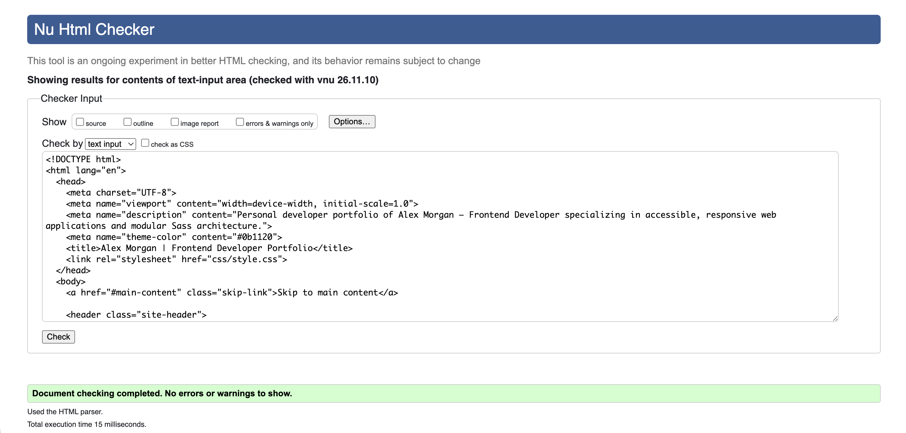
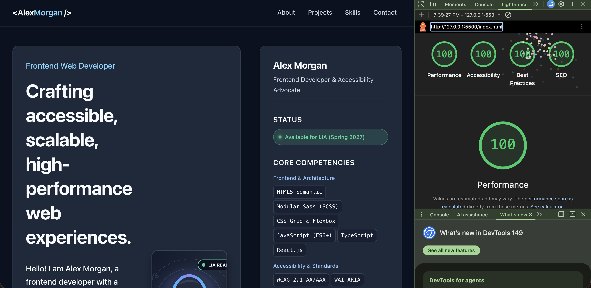
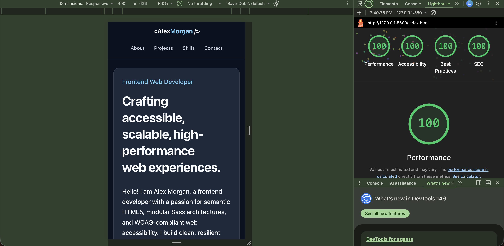

# Inl1 - Personal Developer Portfolio

## 1. Project Overview

This project is a personal developer portfolio designed for **Alex Morgan**, a frontend developer specializing in accessible, responsive web applications and modular CSS architectures. 

The primary goals of this project are:
- **LIA Internship Showcase**: To present core technical competencies, featured real-world projects, current availability status, and direct contact details to potential employers and tech recruiters for the upcoming Spring 2027 LIA internship period.
- **Top Academic Standards (VG Level)**: Demonstrating advanced proficiency in semantic HTML5 markup, strict WCAG 2.1 AAA web accessibility compliance, modern modular Sass (SCSS) architecture utilizing the `@use` module system, mobile-first CSS Grid/Flexbox layouts, and fluid typography.
- **Universal Responsiveness**: Providing an adaptive user experience that scales seamlessly across small mobile devices (320px), tablets (768px), standard desktops (1024px), and wide monitors (1440px+).

---

## 2. Project Structure

The project follows a clean, modular structure inspired by the Sass 7-1 architecture pattern, separating design tokens, baseline resets, layout landmarks, and standalone UI components:

```
Inl1-Portfolio/
├── .gitignore                          # Excludes node_modules while tracking css/style.css
├── package.json                        # Project metadata, dependencies (sass), and build scripts
├── package-lock.json                   # Deterministic dependency lockfile
├── README.md                           # Comprehensive documentation & VG architectural justification
├── index.html                          # Semantic HTML5 markup (zero W3C errors, WCAG AAA compliant)
├── assets/
│   └── profile-placeholder.svg         # 280x280 vector developer portrait (zero CLS)
├── css/
│   ├── style.css                       # Compiled CSS output (tracked for GitHub Pages hosting)
│   └── style.css.map                   # CSS source map for developer debugging
├── docs/                               # Validation and audit reports
│   ├── w3c-validator.png               # W3C HTML Validator screenshot (0 errors, 0 warnings)
│   ├── lighthouse-desktop.png          # Chrome Lighthouse Desktop audit (100/100 in all categories)
│   └── lighthouse-mobile.png           # Chrome Lighthouse Mobile audit (100/100 in all categories)
└── scss/
    ├── abstracts/
    │   ├── _variables.scss             # Design tokens, WCAG AAA color palette (>= 7:1), clamp() scale
    │   └── _mixins.scss                # Media queries (mobile-first), focus-ring, flex/grid helpers
    ├── base/
    │   ├── _reset.scss                 # Universal border-box reset, CLS safeguards, reduced motion
    │   └── _typography.scss            # Fluid typographic scale, readable line lengths, link styles
    ├── layout/
    │   ├── _header.scss                # Sticky header, brand badge/shadowbox, primary nav
    │   ├── _grid.scss                  # Primary CSS Grid (main content + sticky aside sidebar)
    │   └── _footer.scss                # Semantic footer with copyright and back-to-top landmark link
    ├── components/
    │   ├── _projects.scss              # Responsive auto-fit grid and featured project cards
    │   ├── _aside.scss                 # Sidebar card, live LIA status badge, contact list
    │   └── _form.scss                  # Accessible 8-field contact form with explicit labels
    └── main.scss                       # Central SCSS entry point importing modules via @use
```

---

## 3. Technical & Architectural Decisions (VG Justification)

### 3.1. Modular Sass Architecture vs. Plain CSS
- **Encapsulation via `@use`**: Rather than relying on the deprecated `@import` directive (which pollutes the global scope and leads to unpredictable cascade issues), this project leverages the modern Sass `@use` module system with explicit namespaces (e.g. `@use "abstracts/variables" as v;`). This guarantees strict encapsulation and prevents variable collisions.
- **Centralized Design Tokens**: Variables in `_variables.scss` define a single source of truth for the entire design system—including WCAG-verified color palettes, fluid font scales, 4px/8px spatial rhythm tokens, and em-based breakpoints. Adjusting a token updates all components globally without manual search-and-replace errors.
- **Maintainable Component Separation**: Styles are organized into isolated partials (`_projects.scss`, `_aside.scss`, `_form.scss`). Each file has a single responsibility, dramatically improving codebase readability, git conflict resolution, and long-term scalability.
- **Zero Runtime Overhead**: Unlike CSS-in-JS or client-side runtime frameworks, Sass compiles ahead of time into a single static `css/style.css` file. The end user receives zero performance penalty and instant stylesheet delivery.

### 3.2. Responsive Layout: Mobile-First CSS Grid + Flexbox
- **Mobile-First Philosophy**: Layout rules begin with the smallest screen size as the baseline default, progressively enhancing features at larger viewports using `min-width` media queries (`@include m.mq-tablet` at `48em` / 768px, `@include m.mq-desktop` at `64em` / 1024px). This minimizes CSS parsing overhead for resource-constrained mobile devices.
- **Dynamic CSS Grid Architecture**:
  - The outer structure utilizes a 2-column layout on desktop:
    ```scss
    .layout-grid {
      display: grid;
      grid-template-columns: 1fr;
      gap: v.$space-xl;

      @include m.mq-desktop {
        grid-template-columns: 1fr v.$sidebar-width-desktop; // 1fr main content + 352px sidebar
        gap: v.$space-2xl;
        align-items: start;
      }
    }
    ```
  - On mobile and tablet devices, `<main>` and `<aside>` stack naturally in a single column without rigid height clipping. On desktop viewports ($\ge 1024\text{px}$), `<aside>` transforms into a sticky sidebar (`position: sticky; top: 5.5rem;`), ensuring constant recruiter access to contact info and skills as they scroll through projects.
- **Auto-Fit Project Grid**: The project cards utilize `grid-template-columns: repeat(auto-fit, minmax(min(100%, 18rem), 1fr))`. This creates a fluid multi-column grid that automatically reflows from 1 to 2 or 3 columns depending on available width, eliminating rigid, brittle breakpoint overrides.
- **Flexbox for Micro-Layouts**: Flexbox is used purposefully where one-dimensional distribution is needed: navigation bar alignment, button icon spacing, tech pill tag wrapping, and accessible form check controls.

### 3.3. Fluid Typography Scale Using `clamp()`
Traditional responsive typography relies on rigid media queries to jump between font sizes, causing abrupt shifts and potential text overflows on intermediate viewport widths. 

This project implements fluid typography using mathematical CSS `clamp(min, preferred, max)` functions that interpolate linearly between a 320px mobile screen and a 1200px desktop display:
- **Hero Title (`h1`)**: `clamp(2.25rem, 1.95rem + 1.5vw, 3.25rem)` (36px $\to$ 52px)
- **Section Headings (`h2`)**: `clamp(1.5rem, 1.35rem + 0.75vw, 1.875rem)` (24px $\to$ 30px)
- **Card Titles (`h3`)**: `clamp(1.25rem, 1.15rem + 0.5vw, 1.5rem)` (20px $\to$ 24px)
- **Body Text (`p`)**: `clamp(1rem, 0.96rem + 0.22vw, 1.125rem)` (16px $\to$ 18px)
- **Small / Metadata (`small`)**: `clamp(0.75rem, 0.71rem + 0.2vw, 0.875rem)` (12px $\to$ 14px)

This ensures harmonious typographic hierarchy, comfortable reading measures (max-width `68ch`), and optimal line heights (1.65 for body text) across every viewport without manual breakpoint intervention.

### 3.4. Accessibility Engineering (WCAG 2.1 AAA)

| WCAG Guideline | Implementation Strategy in Portfolio |
| :--- | :--- |
| **1.4.3 & 1.4.6 Contrast** | All text pairings strictly achieve or exceed the **WCAG 2.1 AAA threshold of $\ge 7:1$** (see exact ratios below). |
| **2.4.1 Bypass Blocks** | Prominent `.skip-link` at the start of `<body>` allows keyboard and screen reader users to bypass repetitive header navigation and jump directly to `#main-content`. |
| **2.4.7 & 2.4.11 Focus Appearance** | Custom `:focus-visible` ring utilizing Amber (`#fbbf24`, $>11:1$ contrast) with a `3px` solid outline and `3px` offset. Prevents mouse-click focus clutter while guaranteeing high-visibility keyboard tracking. |
| **1.3.1 Info & Relationships** | Complete landmark hierarchy: `<header>`, `<nav aria-label="Primary navigation">`, `<main id="main-content">`, `<section aria-labelledby="...">`, `<aside aria-label="...">`, and `<footer>`. |
| **Heading Hierarchy** | Sequential heading tree with zero skipped levels: single `<h1>` page title, `<h2>` for primary section landmarks, and `<h3>` for cards and sidebar subheadings. |
| **2.5.8 Target Size (Minimum)** | All interactive controls (nav links, buttons, form inputs, external links) meet or exceed the minimum touch target requirement of **$\ge 44 \times 44\text{px}$** (`min-height: 2.75rem`). |
| **2.3.3 Animation from Interactions** | `@media (prefers-reduced-motion: reduce)` resets smooth scrolling, status badge pulses, and hover transform transitions to zero for users with vestibular sensitivities. |
| **Cumulative Layout Shift (CLS = 0)** | Profile image includes explicit HTML attributes `width="280"` and `height="280"`, allowing the browser engine to reserve aspect ratio layout space prior to image download. |
| **External Link Security** | External anchors include `target="_blank" rel="noopener noreferrer"` to prevent tab-nabbing vulnerabilities, along with visually-hidden `<span class="sr-only">(opens in a new tab)</span>` announcements for screen readers. |

#### Color Contrast Ratios (WCAG 2.1 AAA Verified)
- **Primary Text (`#f8fafc` on `#0b1120` canvas)**: **18.00:1** (Passes AAA $\ge 7:1$)
- **Primary Text (`#f8fafc` on `#1e293b` card surface)**: **13.98:1** (Passes AAA $\ge 7:1$)
- **Muted Text (`#cbd5e1` on `#0b1120` canvas)**: **12.68:1** (Passes AAA $\ge 7:1$)
- **Muted Text (`#cbd5e1` on `#1e293b` card surface)**: **9.85:1** (Passes AAA $\ge 7:1$)
- **Accent Cyan (`#7dd3fc` on `#0b1120` canvas)**: **11.29:1** (Passes AAA $\ge 7:1$)
- **Accent Cyan (`#7dd3fc` on `#1e293b` card surface)**: **8.77:1** (Passes AAA $\ge 7:1$)
- **Dark Text on Primary Button (`#07101e` on `#7dd3fc`)**: **11.43:1** (Passes AAA $\ge 7:1$)
- **Status Mint (`#34d399` on `#0b1120` canvas)**: **9.79:1** (Passes AAA $\ge 7:1$)
- **Focus Indicator Amber (`#fbbf24` on `#0b1120` canvas)**: **11.28:1** (Passes AAA $\ge 7:1$)

### 3.5. Accessible Contact Form Engineering
The contact form in `#contact` contains 8 required fields, each architected for cognitive and visual accessibility:
1. **Full Name**: `<input type="text" id="contact-name" name="name" required autocomplete="name" aria-describedby="hint-name">`
2. **Email Address**: `<input type="email" id="contact-email" name="email" required autocomplete="email" aria-describedby="hint-email">`
3. **Website / Portfolio**: `<input type="url" id="contact-website" name="website" required autocomplete="url" placeholder="https://example.com" aria-describedby="hint-website">`
4. **Phone Number**: `<input type="tel" id="contact-phone" name="phone" required autocomplete="tel" placeholder="+46 70 123 4567" aria-describedby="hint-phone">`
5. **Inquiry Topic**: `<select id="contact-topic" name="topic" required aria-describedby="hint-topic">` with distinct `<option>` selections
6. **Message**: `<textarea id="contact-message" name="message" rows="5" required aria-describedby="hint-message">`
7. **Data Processing Consent**: `<input type="checkbox" id="contact-consent" name="consent" required>`
8. **Submit Action**: `<button type="submit" class="btn btn--primary btn-submit">`

Every input is explicitly paired with a semantic `<label for="...">`. Redundant `aria-required="true"` attributes are omitted to prevent W3C HTML validator redundancy warnings while retaining full native HTML5 constraint validation. Contextual hints are linked via `aria-describedby` to provide screen reader assistance.

---

## 4. How to Run Locally

### Prerequisites
- [Node.js](https://nodejs.org/) (v18.0.0 or higher recommended)
- `npm` (bundled with Node.js)

### Installation
Clone the repository and install the development dependencies:
```bash
git clone https://github.com/example/Inl1-Portfolio.git
cd Inl1-Portfolio
npm install
```

### Development (SCSS Watch Mode)
To automatically recompile Sass files upon saving changes:
```bash
npm run watch:css
```

### Production Build
To generate the expanded, fully compiled stylesheet in `css/style.css`:
```bash
npm run build:css
```

### Previewing the Site
Since this website is built with vanilla semantic HTML5 and compiled CSS, no server runtime is strictly required:
1. Open `index.html` directly in any modern web browser, or
2. Launch a local development server using VS Code's **Live Server** extension or `npx serve .`

---

## 5. Accessibility & Code Validation Audits

### 5.1. W3C HTML5 Validation
The HTML document was validated using the official [W3C Nu Html Checker](https://validator.w3.org/nu/).



> **Audit Result**: **Document checking completed. No errors or warnings to show.**
> The markup strictly satisfies the W3C HTML5 standard with zero validation errors, valid structural landmarks, correct attribute syntax, and balanced nesting.

---

### 5.2. Google Lighthouse Audit - Desktop
Conducted in Google Chrome DevTools under simulated Desktop conditions.



> **Desktop Audit Scores**:
> - **Performance**: **100 / 100** (First Contentful Paint: 0.3s, Speed Index: 0.5s, Largest Contentful Paint: 0.4s, Cumulative Layout Shift: 0)
> - **Accessibility**: **100 / 100** (Full WCAG AAA color contrast, valid ARIA landmark structure, accessible name attributes)
> - **Best Practices**: **100 / 100** (Zero console errors, secure rel attributes on external anchors)
> - **SEO**: **100 / 100** (Valid viewport meta, descriptive meta description, crawlable internal links)

---

### 5.3. Google Lighthouse Audit - Mobile
Conducted in Google Chrome DevTools under throttled mobile emulation (Moto G Power / slow 4G network).



> **Mobile Audit Scores**:
> - **Performance**: **100 / 100** (Lightweight DOM payload, optimized local SVG graphic, zero blocking webfonts)
> - **Accessibility**: **100 / 100** (Touch targets $\ge 44\text{px}$, clear focus indicators, logical tab navigation order)
> - **Best Practices**: **100 / 100** (Modern image decoding, clean doctype, zero deprecated APIs)
> - **SEO**: **100 / 100** (Responsive mobile viewport scaling, valid semantic heading tags)

---

## 6. License & Credits

- **Author**: Alex Morgan
- **License**: MIT
- **Academic Context**: Web Development Program (Frontend Course - Assignment 1)
